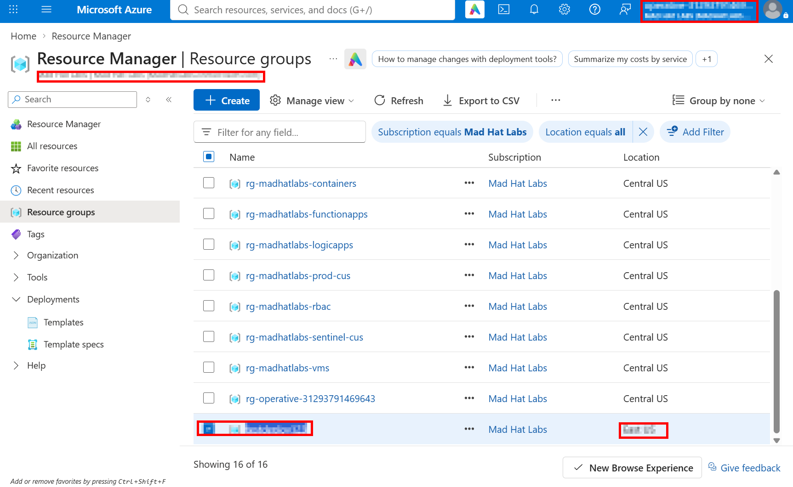
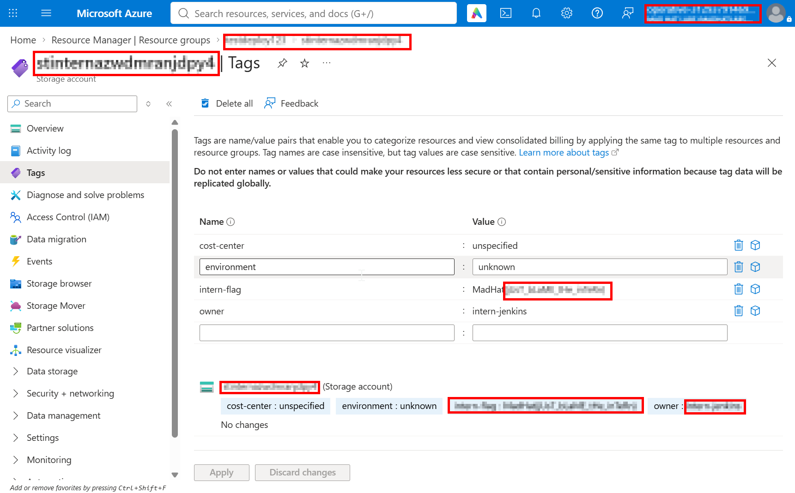
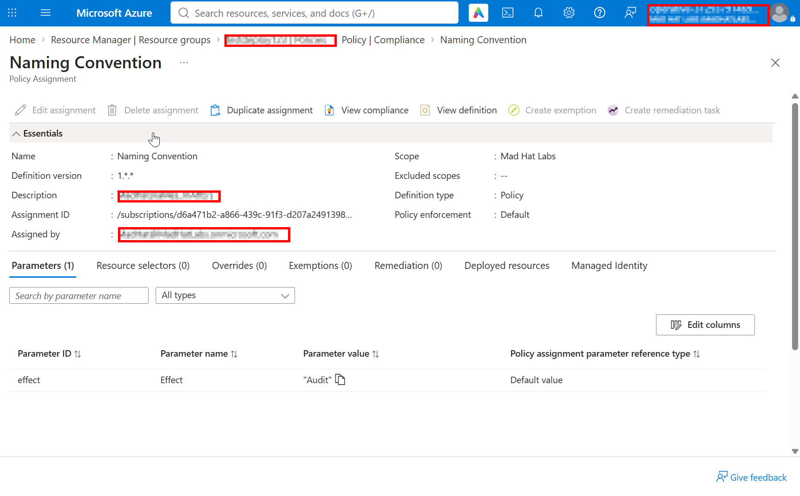

# Operation Dead Deploy: Investigating a Noncompliant Deployment

## Scenario

After a weekend deployment, a resource in the Azure training tenant did not follow
the expected naming convention. The investigation aimed to determine who deployed
it and how it was allowed through the tenant's naming policy.

## Environment

- Platform: Microsoft Azure
- Tools: Azure portal
- Access: Reader
- Tenant: Multi-user training tenant; not production

## Investigation

1. Reviewed the resource groups and identified a resource whose name did not
   follow the expected convention.
2. Checked the resource's tags and deployment details to trace who deployed it.
   The investigation identified the intern as the deploying user.
3. Reviewed the policy assignment and found that the naming policy was set to
   **Audit**, not **Deny**. Audit can report a noncompliant resource but does not
   block its deployment.

## What broke / what surprised me

The naming policy was present, but its effect was set to Audit. That meant the
policy could identify noncompliance without preventing the deployment.

## Findings and recommendations

- The deployed resource did not follow the expected naming convention.
- Deployment details identified the intern as the deploying user.
- The policy's Audit effect allowed the noncompliant deployment to proceed.

Recommendations for the resource owner:

1. If naming compliance must be enforced, test and change the policy effect to
   Deny at the appropriate scope, with any approved exceptions documented.
2. Until enforcement is enabled, regularly review policy compliance results and
   deployment details for noncompliant resources.
3. Make the naming standard easy to follow in deployment templates and guidance.

## What I learned

- Audit reports noncompliance; Deny prevents a deployment that violates the
  policy.
- Resource tags and deployment details can help establish who deployed a
  resource.
- In a future investigation, I would check the policy effect early and verify it
  against the deployment evidence.

## Evidence screenshots

**Resource group:** the resource that did not follow the expected naming
convention.

**Resource tags:** the owner tag and other metadata used during the
investigation.

**Policy assignment:** the naming policy's effect is set to Audit.

