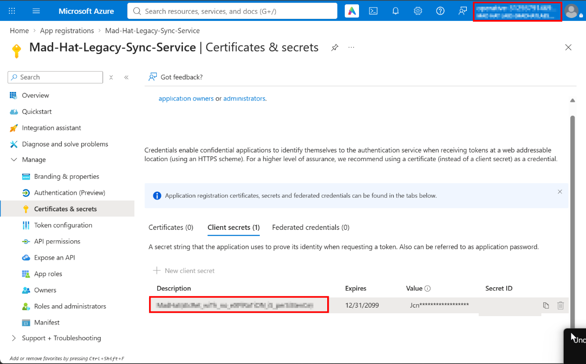
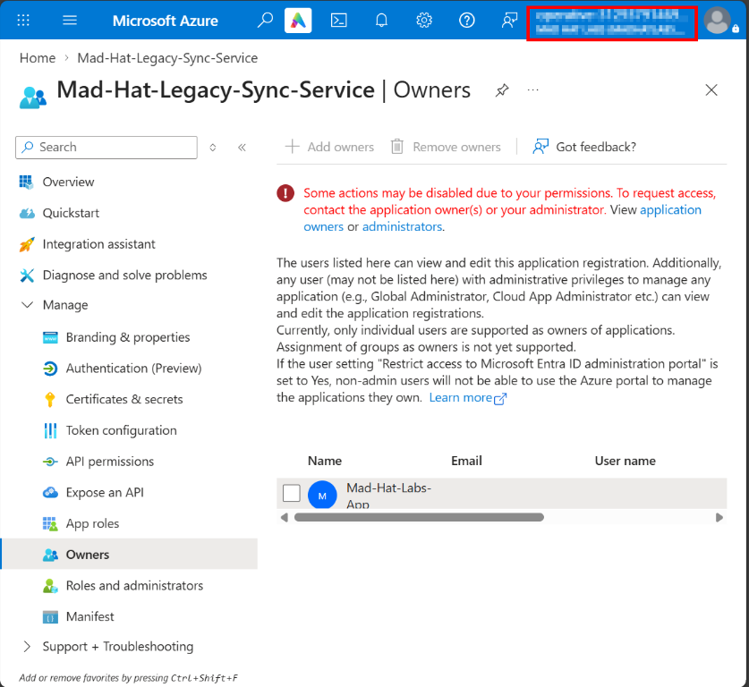
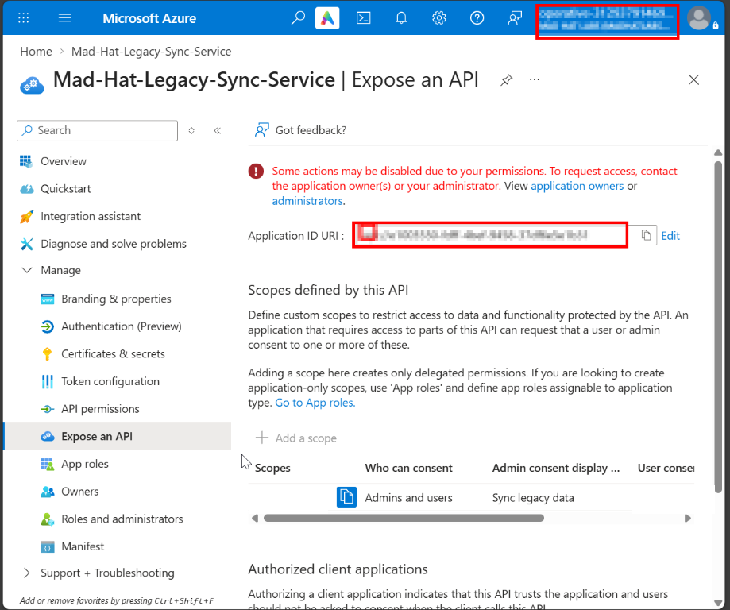
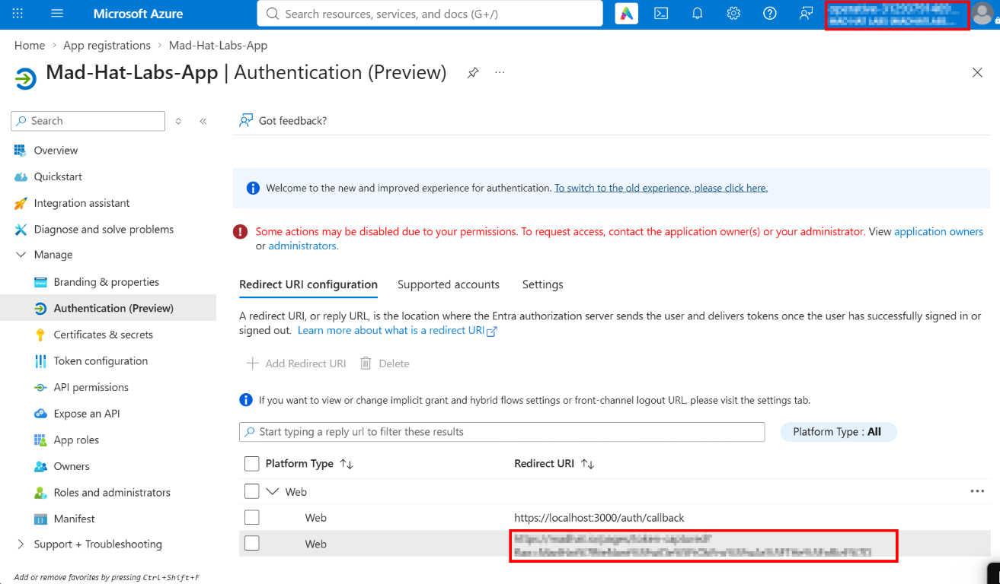
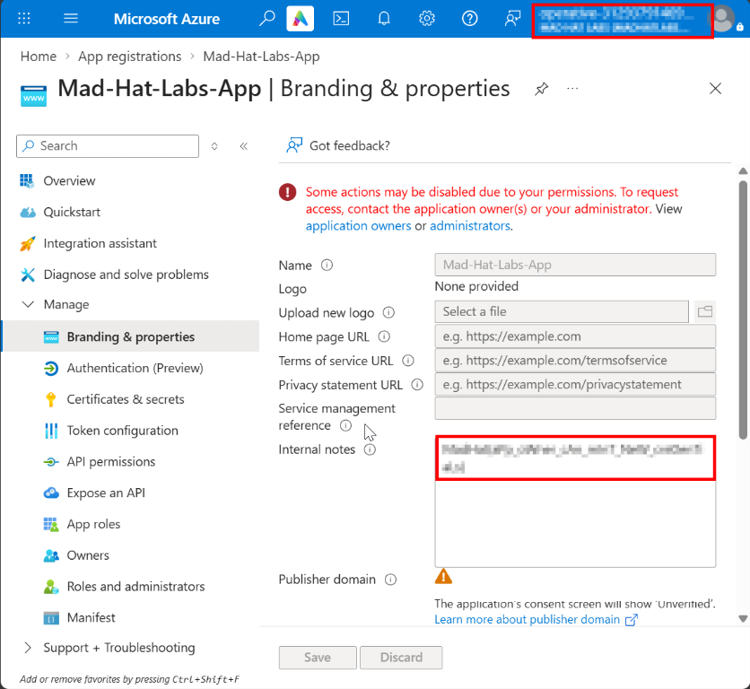

# The Stolen Identity: Investigating a Rogue App Registration

## Scenario

An attacker who gained access to a standard employee account was reported to have used the account's ownership of a legacy Microsoft Entra application to change its configuration. The investigation focused on a client secret with a 2099 expiration date, an unfamiliar owner entry, a custom API scope, and an external web redirect URI.

The goal was to understand which application-level access could persist beyond a password reset and identify what evidence is still needed to confirm whether the suspicious configuration was used.

## Environment

- Platform: Microsoft Azure and Microsoft Entra ID
- Tools: Azure portal
- Access: Application settings were reviewed in the portal; some actions were unavailable due to permissions
- Tenant: Mad Hat Labs multi-user training environment; not production

## Investigation

1. Reviewed the legacy app registration, `Mad-Hat-Legacy-Sync-Service`. The lab notes identify the compromised employee as an owner, though the screenshots included here do not show that employee in the Owners list.
2. Reviewed **Certificates & secrets**. The screenshot shows a client secret expiring on December 31, 2099. This is a strong credential-lifetime anomaly. The screenshot does not establish whether the secret was used or which permissions the application had.
3. Reviewed **Owners**. The list shows an entry named `Mad-Hat-Labs-App`. A display name does not identify whether the directory object is a user or a service principal, so its object type and ID must be verified before classifying it.
4. Reviewed **Expose an API**. The legacy app has a custom delegated scope. A configured scope can be requested by clients, but its presence alone does not prove a client received consent or accessed the API.
5. Reviewed **Authentication** on `Mad-Hat-Labs-App`. The app has a web redirect URI, including an external URI. A redirect configuration alone does not prove that a user consented or that an authorization code was captured.
6. Identified the follow-up evidence needed to determine impact: Entra audit logs for app changes and consent events; user and service-principal sign-in logs; app credentials and permissions; owner object IDs and types; delegated consent grants; and app role assignments.

## What broke / what surprised me

Resetting a compromised user's password and revoking their sessions does not automatically remove application credentials, owner relationships, OAuth grants, or app role assignments. These are separate parts of the identity environment and need to be reviewed during containment.

I also learned to distinguish suspicious configuration from confirmed exploitation. The screenshots show a long-lived secret, an owner entry, a delegated scope, and a redirect URI, but they do not prove that the secret was used, that the owner entry is a service principal, or that a user authorized the app.

## Findings and recommendations

- A client secret on the legacy app is configured to expire in 2099.
- The legacy app's Owners list contains an entry named `Mad-Hat-Labs-App`; its directory object type still needs verification.
- The legacy app exposes a custom delegated API scope; associated client permissions and consent grants need review.
- `Mad-Hat-Labs-App` has an external web redirect URI; confirm the OAuth flow and investigate consent and sign-in activity before concluding that authorization data was exposed.
- The lab notes report that a compromised employee account owned the legacy app; validate this relationship against the directory and audit records.

Recommendations for the tenant administrator:

1. Preserve relevant audit and sign-in evidence, then contain the compromised user and revoke their sessions.
2. Confirm whether the 2099 secret is unauthorized or was used. Remove it if unauthorized and rotate any credentials that may have been exposed.
3. Resolve unexpected owners to directory object IDs and types. Remove confirmed unauthorized owners and review their credentials, permissions, and activity.
4. Review delegated `OAuth2PermissionGrant` objects and app role assignments for the affected client and resource. Remove only permissions confirmed to be unauthorized; account for already-issued tokens.
5. Remove the external redirect URI or custom scope if confirmed unauthorized. Check for legitimate dependencies before deleting an in-use scope.
6. Restrict application registration and user consent according to the organization's approval process. Periodically review owners and alert on unexpected credential, owner, redirect URI, and consent changes.

## What I learned

- Application ownership can grant meaningful control over an app without giving the owner a directory administrator role.
- Workload credentials and OAuth grants are distinct from a user's password and interactive session.
- A long-lived credential is an investigation lead; audit and sign-in records are needed to determine whether it was used.
- A display name, API scope, or redirect URI alone does not prove the related identity type, consent, or access.
- In a future investigation, I would record object IDs early and correlate audit events, permissions, consent grants, and service-principal sign-ins before cleanup.

## Evidence screenshots

**Client secret:** the legacy app's client secret expiration date is December 31, 2099. The secret value and secret ID are obscured.

**Owner entry:** the Owners list displays `Mad-Hat-Labs-App`. The screenshot does not establish the directory object type.

**Custom API scope:** the legacy app exposes a delegated scope. Partial identifiers are obscured; scope configuration alone does not prove consent or access.

**Redirect URI:** the Authentication page shows configured web redirect URIs. The external URI and account details are obscured.

**App branding:** additional registration context from the Branding & properties page. The tenant publisher domain and account details are obscured.

